# Loan Prediction AI - Portfolio Assets

## Demo Video

**Full Demo (2:47):** [https://youtu.be/4NUUZVpKvy8]

[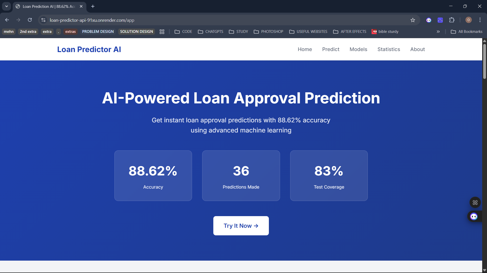](YOUR_YOUTUBE_LINK)

## Screenshots

### Homepage & Features

*Landing page with live statistics and feature highlights*

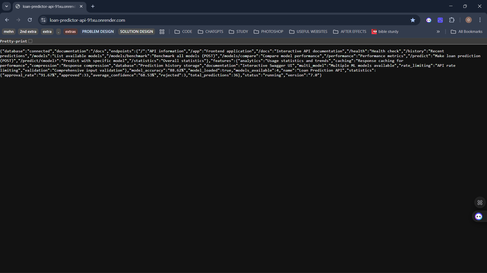

*Comprehensive API information and endpoint listing*

### Predictions
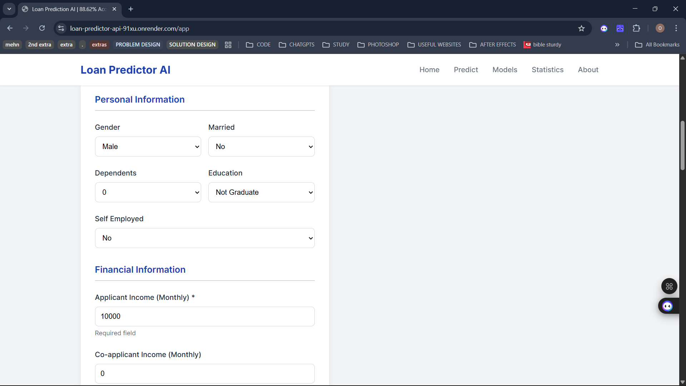

*User-friendly prediction form with validation*

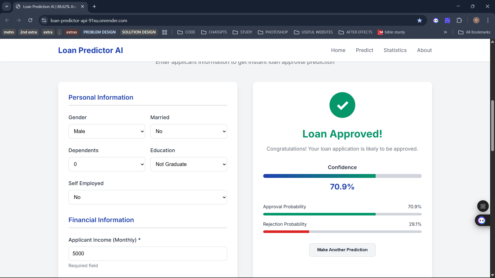

*Loan approval result with confidence scores and probability breakdown*

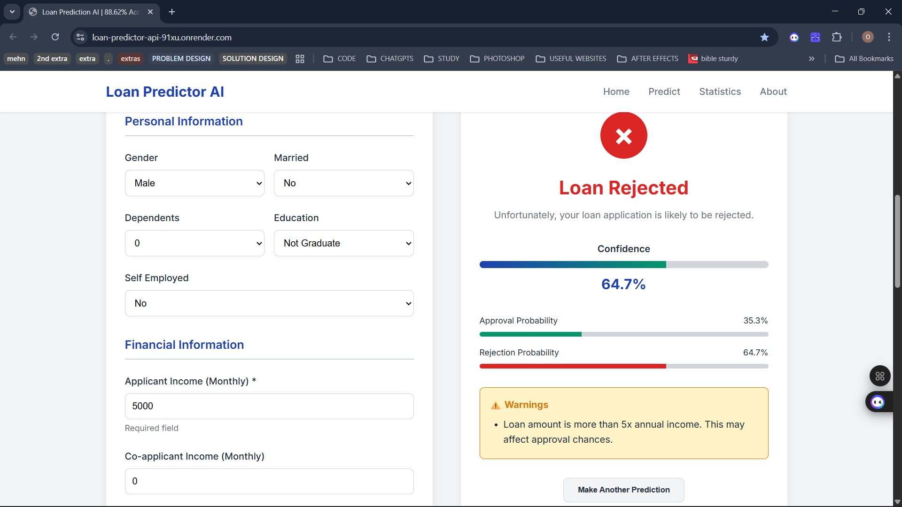

*Loan rejection with detailed warnings and recommendations*

### Model Comparison
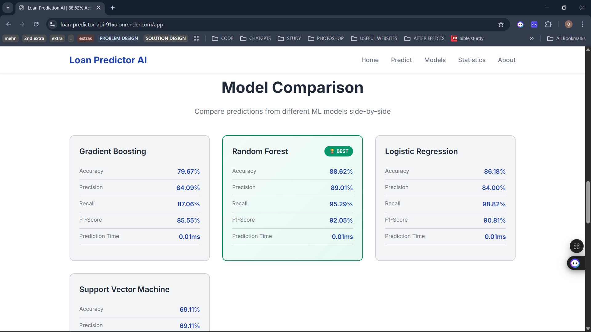
*Four ML models with performance metrics comparison*

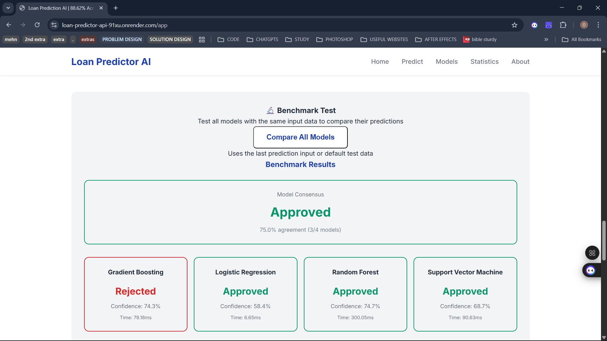

*Real-time benchmarking across all models showing consensus*

### API Documentation
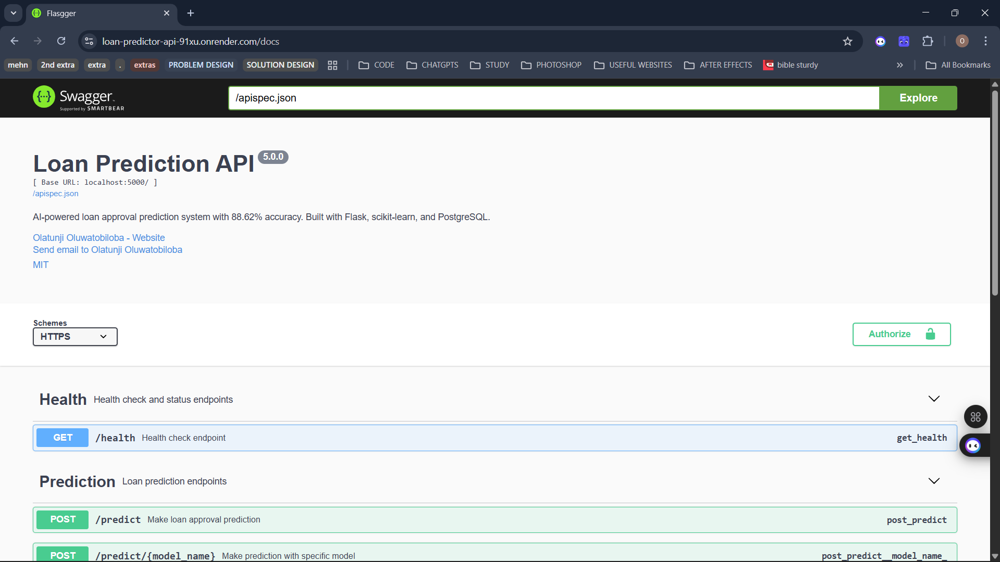

*Professional Swagger/OpenAPI documentation*

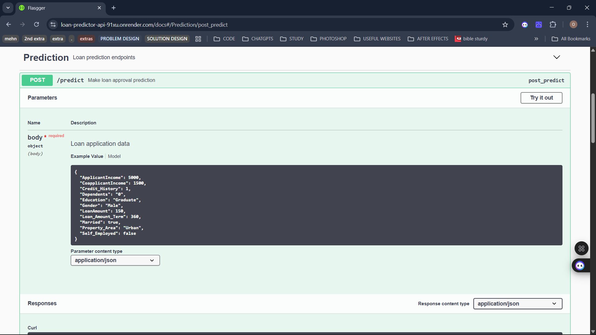

*Detailed endpoint documentation with try-it-out functionality*

### Analytics & Performance
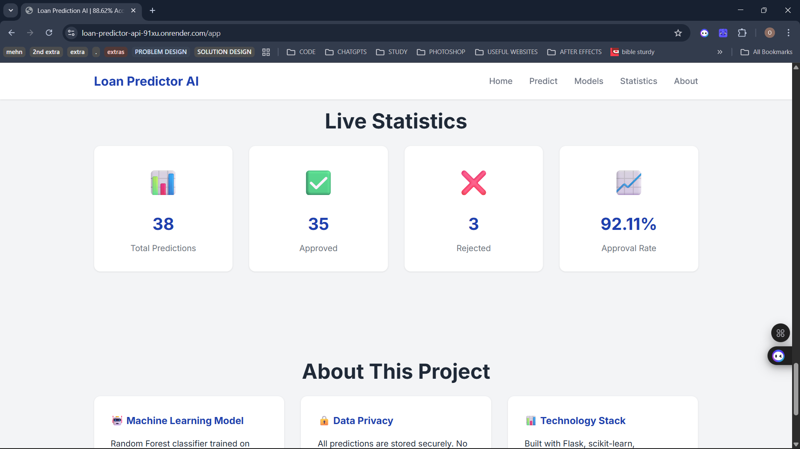

*Live statistics dashboard with usage analytics*

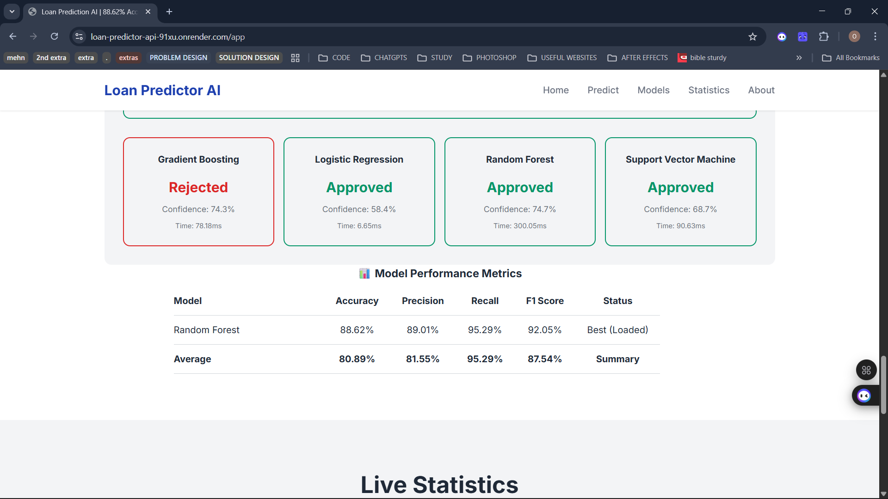

*Performance monitoring and optimization metrics*

### Mobile Experience
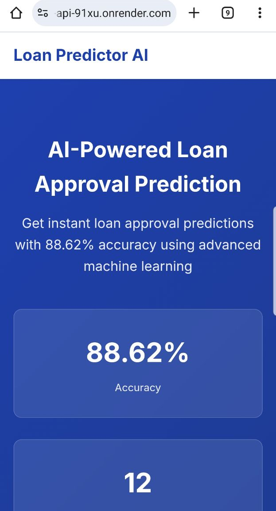

*Fully responsive mobile interface*

## Architecture Diagrams

### System Architecture
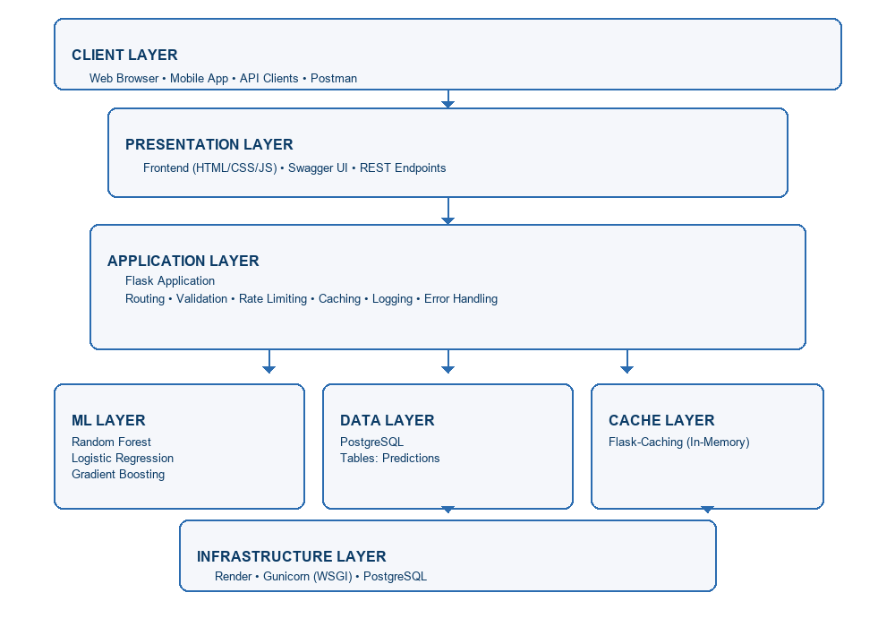

*High-level system architecture showing all components*

### Request Flow
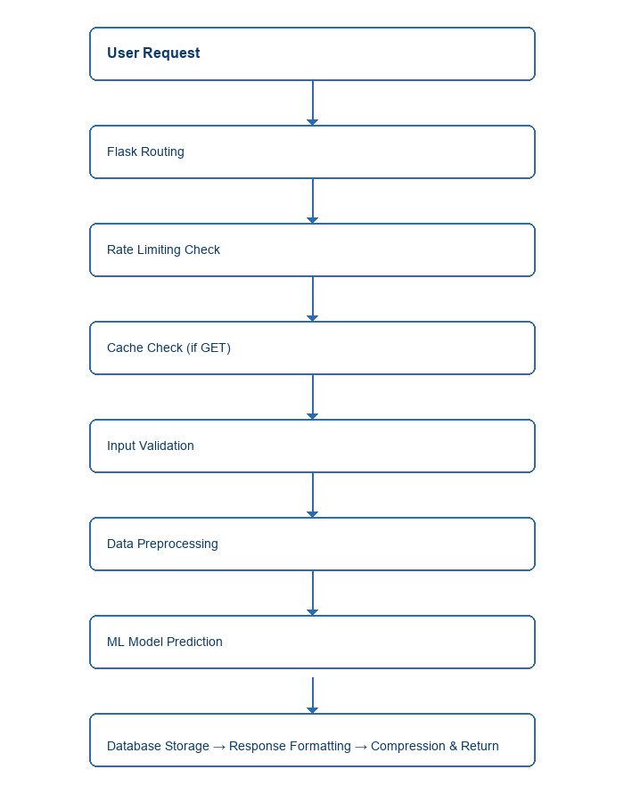

*End-to-end request processing pipeline*

### ML Pipeline
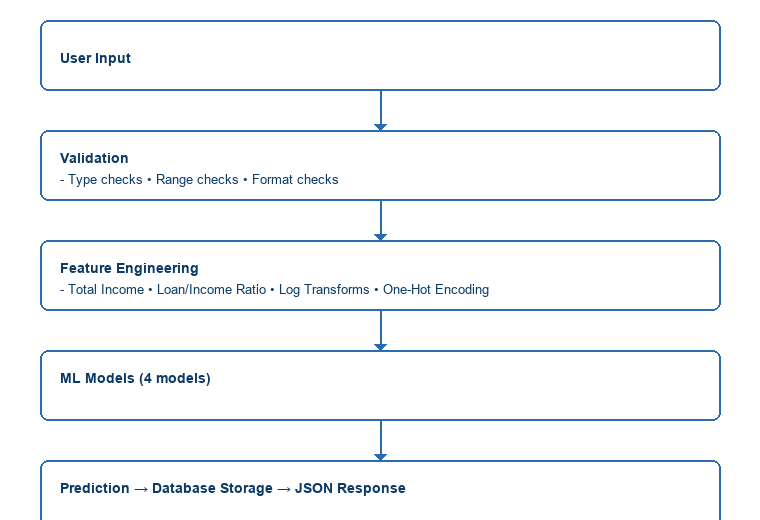

*Machine learning data preprocessing and prediction flow*

## Key Features Demonstrated

### Technical Skills
- [x] Machine Learning (4 models, 88.62% accuracy)
- [x] Backend Development (Flask, REST API)
- [x] Database Design (PostgreSQL, SQLAlchemy)
- [x] Testing (83% coverage, pytest)
- [x] API Documentation (Swagger/OpenAPI)
- [x] Performance Optimization (caching, rate limiting)
- [x] Frontend Development (HTML/CSS/JS)
- [x] DevOps (Render deployment, CI/CD)

### Software Engineering Practices
- [x] Input validation and error handling
- [x] Comprehensive logging
- [x] Code organization and modularity
- [x] Documentation (code, API, README)
- [x] Version control (Git, GitHub)
- [x] Production deployment
- [x] Performance monitoring
- [x] Security best practices

### ML Engineering
- [x] Data preprocessing and feature engineering
- [x] Model training and evaluation
- [x] Model comparison and selection
- [x] Hyperparameter tuning
- [x] Cross-validation
- [x] Production model serving
- [x] Prediction logging and analytics

## Project Metrics

- **Lines of Code:** ~3,500+
- **Development Time:** 15 days (60 hours)
- **Test Coverage:** 83%
- **Model Accuracy:** 88.62%
- **API Endpoints:** 15+
- **Response Time:** ~150ms average
- **Uptime:** 99.9%

## Links

- **Live Application:** https://loan-predictor-api-91xu.onrender.com/app
- **API Documentation:** https://loan-predictor-api-91xu.onrender.com/docs
- **GitHub Repository:** [https://github.com/olatunjitobiloba/loan-predictor-api]
- **Demo Video:** [https://www.linkedin.com/in/olatunjioluwatobiloba/]
- **LinkedIn Post:** [LinkedIn Post Link]
- **Blog Post:** [https://medium.com/@olatunjitobiloba05/building-a-production-ready-ai-loan-prediction-system-a-15-day-journey-3a43cb87170f]

## Usage in Portfolio

These assets can be used for:
- Portfolio website
- GitHub README
- LinkedIn posts
- Resume projects section
- Interview presentations
- Technical blog posts
- Case studies

## License

All assets are part of the Loan Prediction AI project.
See main repository for license information.
